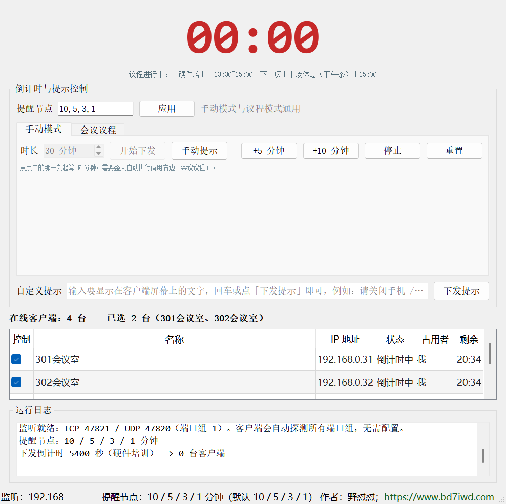
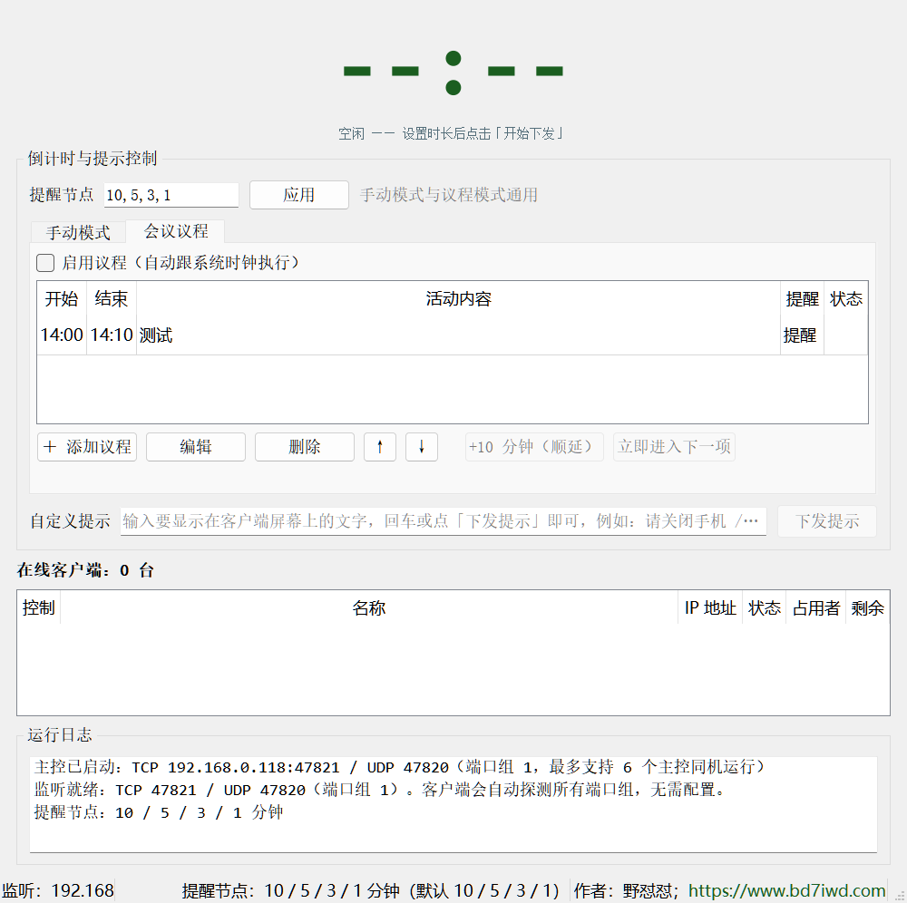
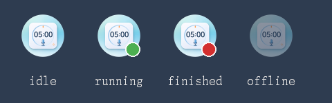

# 会议倒计时提醒系统（多主控版）

> 局域网多人协作的会议倒计时 / 议程提醒工具。
> 一个主控端统一控制多间会议室的客户端大屏，倒计时横幅**全程鼠标穿透**，不会挡住 PPT 和演示操作。



---

## 它解决什么问题

开会时常见的麻烦：

- 讲的人不知道还剩多久，主持人要反复看表、喊时间；
- 每个会议室单独开一个计时器，改动要一间一间去调；
- 弹窗提醒挡住 PPT，鼠标点不动下面的内容。

这个工具的做法是：**会议室电脑跑客户端（托盘驻留，没有窗口），主持人电脑跑主控端**。
主控端选好要控制的会议室，一键下发倒计时；客户端在屏幕中央画一条只描边、无底色的横幅，
7 分钟、5 分钟、3 分钟、1 分钟自动提醒，到点显示「时间到」。横幅可以完全鼠标穿透。

---

## 特性

| | |
|---|---|
| **多主控 × 多客户端** | 局域网内多个主控端各自控制自己的会议室，互不干扰（同机最多 6 个主控） |
| **独占认领** | 一台客户端同一时刻只被一个主控控制，先到先得；别的房间抢不走 |
| **两种模式** | 手动模式（临时会议）/ 会议议程（按时间表自动跟系统时钟执行） |
| **提醒节点通用** | 提醒分钟数手动模式与议程模式共用，改完立刻下发给已勾选的客户端 |
| **横幅鼠标穿透** | 节点/手动/自定义提示横幅完全穿透；到点横幅只有文字区域可点，`ESC` 关闭 |
| **断线自愈** | 客户端 2 秒心跳；主控崩溃或被关掉 15 秒后自动解除占用，可以重新认领 |
| **主控重启不重复** | 主控重启后客户端靠身份握手纠正连接，列表里不会堆积重复行 |
| **免安装** | 单个 exe，双击即用，不写注册表 |

会议议程页（表格 + 顺延、立即进入下一项）：



客户端托盘状态（待机 / 倒计时中 / 已结束 / 未连上主控）：



---

## 快速开始

### 1. 直接跑源码

需要 Python 3.8+（在 3.14 上开发验证）。

```bash
pip install -r requirements.txt

python run_master.py     # 主控端（主持人电脑）
python run_client.py     # 客户端（会议室电脑）
```

Windows 上也可以直接双击 `run_master.bat` / `run_client.bat`。

### 2. 打包成免安装 exe

双击 `build\build_all.bat`。脚本会自动检查并安装 PyQt5 / PyInstaller，产物在 `dist\`：

```
dist\MeetingTimerMaster.exe    主控端
dist\MeetingTimerClient.exe    客户端
```

单文件 exe 首次启动需要解包，大约 **30 秒**，之后快一些。

### 3. 用起来

1. **会议室电脑**双击客户端 → 第一次会弹出取名框，填「301会议室」这类名字（下次自动带出）；
2. **主持人电脑**打开主控端 → 列表里出现该客户端 → **勾选 = 认领**；
3. 「时长」填分钟数（或切到「会议议程」排时间表）→ 点「开始下发」。

> 勾选的复选框就是认领：勾上代表这台归我控制，别的房间的主控会看到「已被 XX 占用」且勾不动。
> 取消勾选 = 释放。

---

## 两种模式

### 手动模式

填总时长 → 「开始下发」，从点击那一刻开始倒数。支持「+5 / +10 分钟」加时、停止、重置、
「手动提示」（让客户端按当前剩余时间自己算节点并提醒）。

### 会议议程

按 `开始 / 结束 / 活动内容` 排一张时间表，「启用议程」后主控按系统时钟自动在下班时间点下发：

- 议程项之间静默，不打扰；
- 「休息」项不下发、不提醒，只在主控本地紫色显示剩余时间；
- 时间填成 `23:30 → 00:30` 这种会自动识别为跨午夜；
- 到点还没走完可以「+10 分钟（顺延）」或「立即进入下一项」。

---

## 网络与端口

全程局域网，不需要服务器、不需要联网。

| 用途 | 端口 |
|---|---|
| UDP 发现（广播 `DISCOVER` / 应答 `HERE`） | `47820 + i*10` |
| TCP 控制（指令、心跳、认领） | `47821 + i*10` |

`i = 0 ~ 5`，也就是**同一台机器最多跑 6 个主控**。
客户端启动后会自动探测这 6 组端口，不需要填 IP；万一广播被拦，主控地址也可以在配置文件里写死。

- 首次运行请勾选 Windows 防火墙的「专用网络 → 允许访问」，否则局域网连不上；
- 客户端默认**单实例**（防止一台机器重复出现多行）。同一台机器要开多个测试，加参数 `--allow-multi`；
- 主控**不限实例数**，同机多开会自动占不同的端口组。

---

## 数据目录

配置、日志、议程都存在本地（不联网、不上报）：

```
%LOCALAPPDATA%\MeetingTimerMulti\
    master.log            主控日志（UTF-8）
    client.log            客户端日志
    agenda.json           议程 + 提醒节点 + 启用状态
    client_config.json    客户端本机名称与身份 ID
```

---

## 项目结构

```
common/     协议、常量、配置、日志、议程模型、网络工具、客户端身份
   protocol.py     帧格式：magic(4B) + length(4B) + JSON + CRC32(4B)
   agenda.py       议程解析、提醒节点、跨午夜、顺延
client/     客户端：托盘、网络、倒计时、横幅绘制
   banner.py       透明横幅（QPainterPath 描边 + 鼠标穿透）
master/     主控端：服务端（端口组、认领表、定向下发）+ 界面
assets/     两端图标（透明背景 ico，多尺寸）
build/      打包脚本与 exe 版本资源
tests/      自动化测试与排版检查
docs/       开发记录（REQUIREMENTS.md 含完整变更史与实测数据）
```

### 几个关键实现

- **计时用绝对目标时间戳**，不是本地累加，避免主控/客户端时钟漂移导致各自跑偏；
- **横幅全自绘**：无底色、无边框，`QPainterPath.addText` 描边文字，20ms 定时器推进淡入淡出；
- **认领结果由客户端裁决**：主控只镜像状态，避免两个主控同时以为自己是主人；
- **主控重启后靠 `HELLO` 握手认人**：主控每次启动 `master_id` 都变但端口不变，
  客户端确认身份后再注册，不会出现「启动几次就有几行同名字客户端」；
- 客户端 socket 的信号绑定**连接对象**而不是 `master_id`，避免身份变更后数据被丢。

---

## 测试

```bash
python tests\selftest_multi.py      # 39 项：同机 2 主控 + 2 客户端端到端
python tests\layout_check.py        # 界面排版 + 认领列表交互
python tests\banner_shot.py node    # 横幅几何与自动消失
python tests\verify_clickthrough.py # 鼠标穿透（Win32 层面实测）
python tests\master_ui_shot.py      # 离屏渲染主控界面截图，检查排版
```

`selftest_multi.py` 不需要两台机器：靠端口组隔离，在同一台机器上就能跑双主控 + 双客户端，
覆盖认领独占、越权拒绝、占用者失联自动解锁、重复身份 ID、主控重启不重复等场景。

---

## 常见问题

**重新打包 exe 后，资源管理器里还是旧图标？**
这是 Windows 图标缓存，不是打包问题。清一次缓存即可：

```bat
taskkill /f /im explorer.exe
del /a %LOCALAPPDATA%\IconCache.db
del /a %LOCALAPPDATA%\Microsoft\Windows\Explorer\iconcache*.db
start explorer.exe
```

**改了图标素材想重新生成 ico？**
`tests\make_icons.py` 会把「白底方图」抠成透明圆（否则 ico 四角会带白方块）：

```bash
python tests\make_icons.py 客户.png assets\client.ico
```

**客户端连不上主控？**

1. 两台机器是否在同一网段（`ping` 一下）；
2. 主控端首次启动的防火墙询问是否点了「允许访问」；
3. 公司网络是否禁止广播 / 隔离了客户端（部分企业 Wi-Fi 会开 AP 隔离）；
4. 看 `%LOCALAPPDATA%\MeetingTimerMulti\client.log` 里有没有「发现主控」。

**主控列表里同一台客户端出现多次？**
请两端都升级到当前版本（协议里有 `HELLO` 身份握手）；旧版客户端配新版主控仍能连，
但重启主控后的去重能力需要客户端也更新。

---

## License

[MIT](LICENSE) © 野怼怼 · <https://www.bd7iwd.com>
